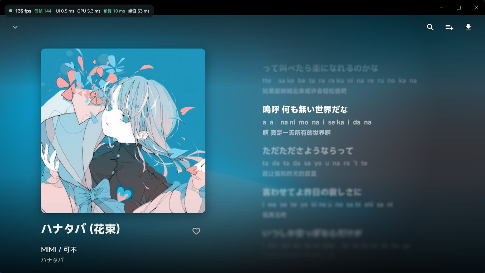
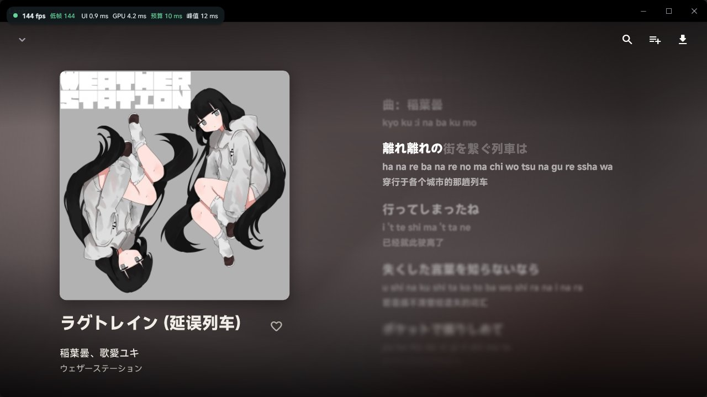
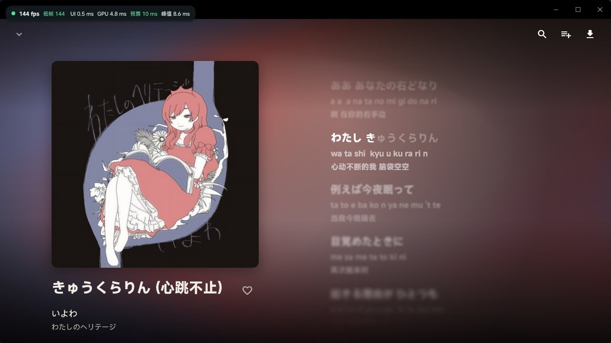
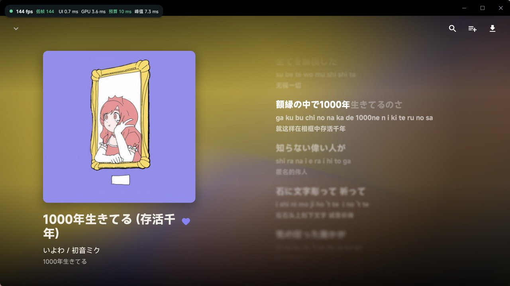
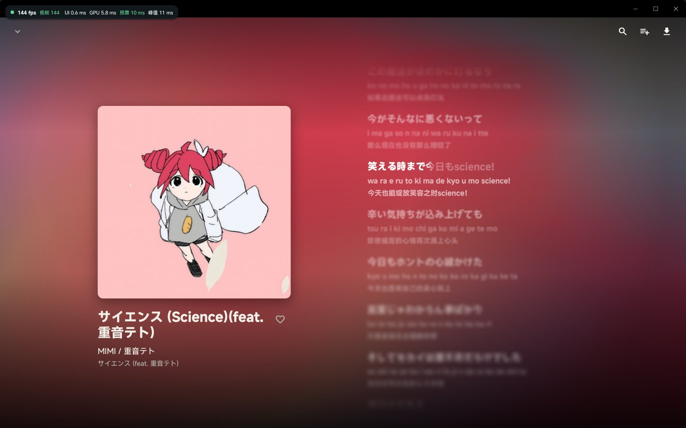
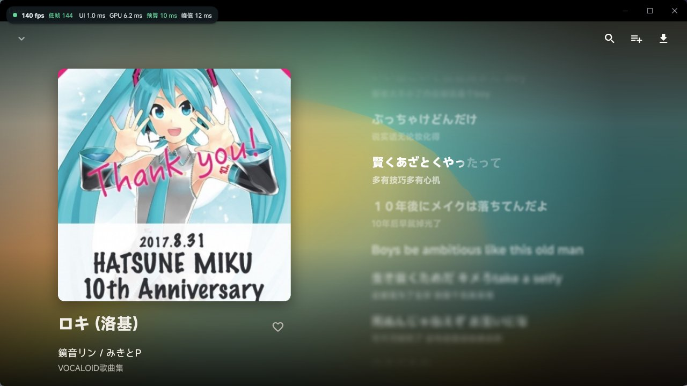
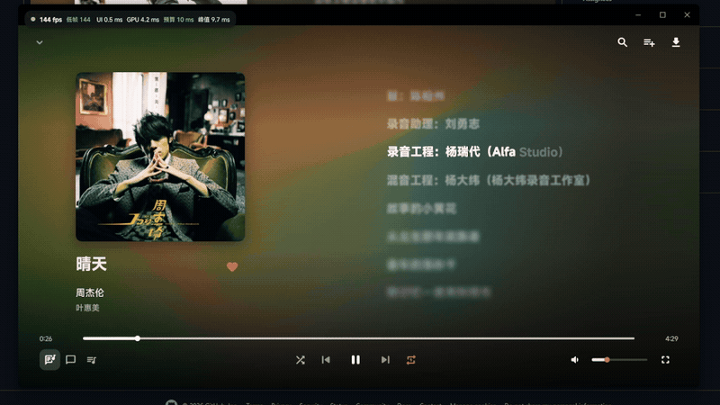
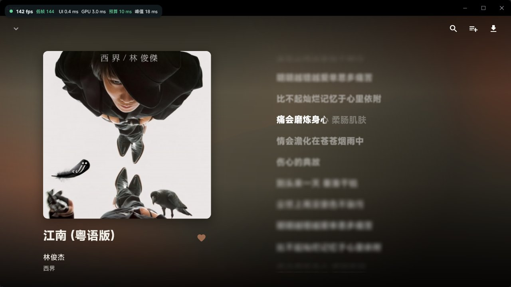

# 🎤 酷狗音乐逐字动感歌词 (KRC) 效果示范与实测曲库

本目录汇总了 `lazer.kugou`（酷狗音乐插件）在 Lazer 客户端原生运行时下的 **KRC 逐字动感歌词、双语翻译与罗马音音译** 的实机播放效果演示与多语种、全曲风的实测高清截图。

---

## 📋 测试套件曲目与截图收录对照表 (Lyrics Test Suite Coverage)

本表格完整对齐自动化测试脚本 [`test/test_lyrics.py`](../../../../test/test_lyrics.py) 内置的 23 首精选曲目，展示各歌曲在 Lazer 客户端下的歌词支持能力及本预览目录的截图收录覆盖状态：

| 分组 / 类别 | 歌曲名称 | 艺术家 | 歌词支持能力 | 截图收录状态 | 对应文件 / 说明 |
| :--- | :--- | :--- | :--- | :---: | :--- |
| **新锐术力口** | **ラグトレイン (延误列车 / Lagtrain)** | 稲葉曇、歌愛ユキ | 🌟 三轨全齐 (原文+罗马音+翻译) | ✅ | [`preview_inabakumori_lagtrain_lyrics.jpg`](preview_inabakumori_lagtrain_lyrics.jpg) |
| **新锐术力口** | **きゅうくらりん (Kyu-kurarin)** | いよわ、可不 | 🌟 三轨全齐 (原文+罗马音+翻译) | ✅ | [`preview_iyowa_kyukurarin_lyrics.jpg`](preview_iyowa_kyukurarin_lyrics.jpg) |
| **新锐术力口** | **1000年生きてる (存活千年)** | いよわ、初音ミク | 🌟 三轨全齐 (原文+罗马音+翻译) | ✅ | [`preview_iyowa_1000years_lyrics.jpg`](preview_iyowa_1000years_lyrics.jpg) |
| **新锐术力口** | **ハナタバ (花束)** | MIMI、可不 | 🌟 三轨全齐 (原文+罗马音+翻译) | ✅ | [`preview_mimi_hanataba_lyrics.jpg`](preview_mimi_hanataba_lyrics.jpg) |
| **新锐术力口** | **サイエンス (Science) (feat. 重音テト)** | MIMI、重音テト | 🌟 三轨全齐 (原文+罗马音+翻译) | ✅ | [`preview_mimi_science_lyrics.jpg`](preview_mimi_science_lyrics.jpg) |
| **新锐术力口** | **今はいいんだよ。 (现在这样就好。)** | MIMI、可不 | 🌟 三轨全齐 (原文+罗马音+翻译) | ❌ | 待补充实测截图 |
| **传世术力口神曲** | **千本桜** | 初音ミク、WhiteFlame | 🌟 三轨全齐 (原文+罗马音+翻译) | ✅ | [`preview_senbonzakura.jpg`](preview_senbonzakura.jpg) |
| **传世术力口神曲** | **深海少女** | 初音ミク、ゆうゆ | 🌟 三轨全齐 (原文+罗马音+翻译) | ✅ | [`preview_shinkai_shoujo.jpg`](preview_shinkai_shoujo.jpg) |
| **传世术力口神曲** | **メルト (Melt)** | Ryo、初音ミク | 🌟 三轨全齐 (原文+罗马音+翻译) | ❌ | 待补充实测截图 |
| **传世术力口神曲** | **ロミオとシンデレラ (罗密欧与辛德瑞拉)** | doriko、初音ミク | 🌟 三轨全齐 (原文+罗马音+翻译) | ❌ | 待补充实测截图 |
| **传世术力口神曲** | **ロキ (ROKI)** | 鏡音リン、みきとP | 🌟 三轨全齐 (原文+罗马音+翻译) | ✅ | [`preview_roki.jpg`](preview_roki.jpg) |
| **传世术力口神曲** | **ヴァンパイア (吸血鬼)** | DECO*27、初音ミク | 🌟 三轨全齐 (原文+罗马音+翻译) | ✅ | [`preview_vampire.jpg`](preview_vampire.jpg) |
| **传世术力口神曲** | **六兆年と一夜物語** | kemu、IA | 🌟 三轨全齐 (原文+罗马音+翻译) | ❌ | 待补充实测截图 |
| **传世术力口神曲** | **ロストワンの号哭** | 鏡音リン、Neru | 🌟 三轨全齐 (原文+罗马音+翻译) | ❌ | 待补充实测截图 |
| **传世术力口神曲** | **神っぽいな (像神一样呐)** | ピノキオピー、初音ミク | 🌟 三轨全齐 (原文+罗马音+翻译) | ❌ | 待补充实测截图 |
| **传世术力口神曲** | **アンノウン・マザーグース (Unknown Mother-Goose)** | wowaka、初音ミク | 🌟 三轨全齐 (原文+罗马音+翻译) | ❌ | 待补充实测截图 |
| **日文流行 (J-Pop)** | **夜に駆ける** | YOASOBI | 🌐 双语翻译 (原文+中文翻译) | ✅ | [`preview_yoasobi_yoru_1.jpg`](preview_yoasobi_yoru_1.jpg) |
| **日文流行 (J-Pop)** | **Lemon** | 米津玄師 | 🌐 双语翻译 (原文+中文翻译) | ✅ | [`preview_lemon.jpg`](preview_lemon.jpg) |
| **日文流行 (J-Pop)** | **幽霊東京** | Ayase、初音ミク | 🌐 双语翻译 (原文+中文翻译) | ❌ | 待补充实测截图 |
| **欧美流行 (Western Pop)** | **Rolling in the Deep** | Adele | 🌐 双语翻译 (英文+中文翻译) | ✅ | [`preview_rolling_in_the_deep.jpg`](preview_rolling_in_the_deep.jpg) |
| **欧美流行 (Western Pop)** | **Shape of You** | Ed Sheeran | 🌐 双语翻译 (英文+中文翻译) | ✅ | [`preview_shape_of_you.jpg`](preview_shape_of_you.jpg) |
| **华语经典流行** | **晴天** | 周杰伦 | 📝 单语极细逐字动感 | ✅ | [`preview_qingtian_lyrics.gif`](preview_qingtian_lyrics.gif) |
| **华语经典流行** | **江南** | 林俊杰 | 📝 单语极细逐字动感 | ✅ | [`preview_jiangnan_yueyu.jpg`](preview_jiangnan_yueyu.jpg) |

> 💡 **状态说明**：
> - ✅：已收录本目录下高清实测截图（并在下文中配有详细展示说明）。
> - ❌：已包含在自动化测试套件中且全量通过接口与解析验证，后续版本中将陆续补充对应 Lazer 播放界面截图。

---

## 🎬 原生三轨歌词播放实录 (原文动感 + 罗马音音译 + 中文双语翻译)

全面支持三轨歌词同步解析与高亮渲染，在播放日文/外语曲目时，可同时展现日文原文动感歌词、罗马音音译及中文双语翻译：

---

## 🖼️ 多语种与全曲风实测效果展示 (与上方表格严格顺序对齐)

### 1. 新锐术力口（いよわ / 稻叶昙 / MIMI）

#### 1. 《ラグトレイン (延误列车 / Lagtrain)》 - 稲葉曇 / 歌愛ユキ (🌟 三轨全齐)

#### 2. 《きゅうくらりん (Kyu-kurarin / 心跳不止)》 - いよわ / 可不 (🌟 三轨全齐)

#### 3. 《1000年生きてる (存活千年)》 - いよわ / 初音ミク (🌟 三轨全齐)

#### 4. 《ハナタバ (花束)》 - MIMI / 可不 (🌟 三轨全齐)

#### 5. 《サイエンス (Science) (feat. 重音テト)》 - MIMI / 重音テト (🌟 三轨全齐)

#### 6. 《今はいいんだよ。 (现在这样就好。)》 - MIMI / 可不 (🌟 三轨全齐)
> ⏳ **[暂无截图]** 该曲目已在测试套件中全量通过三轨歌词解析验证，实机截图待补充。

---

### 2. 传世术力口经典神曲 (Vocaloid Classics)

#### 7. 《千本桜》 - 初音ミク / WhiteFlame (传世快节奏，逐字高亮)

#### 8. 《深海少女》 - 初音ミク / ゆうゆ (经典抒情，双语逐字与中文翻译 1:1 绝对对齐)

#### 9. 《メルト (Melt)》 - Ryo / 初音ミク (🌟 三轨全齐)
> ⏳ **[暂无截图]** 该曲目已在测试套件中全量通过解析验证，实机截图待补充。

#### 10. 《ロミオとシンデレラ (罗密欧与辛德瑞拉)》 - doriko / 初音ミク (🌟 三轨全齐)
> ⏳ **[暂无截图]** 该曲目已在测试套件中全量通过解析验证，实机截图待补充。

#### 11. 《ロキ (ROKI)》 - 鏡音リン / みきとP (70 行超高燃高频对唱打点)

#### 12. 《ヴァンパイア (吸血鬼)》 - DECO*27 / 初音ミク (72 行现代高热度密集跟随)

#### 13. 《六兆年と一夜物語》 - kemu / IA (🌟 三轨全齐)
> ⏳ **[暂无截图]** 该曲目已在测试套件中全量通过解析验证，实机截图待补充。

#### 14. 《ロストワンの号哭》 - 鏡音リン / Neru (🌟 三轨全齐)
> ⏳ **[暂无截图]** 该曲目已在测试套件中全量通过解析验证，实机截图待补充。

#### 15. 《神っぽいな (像神一样呐)》 - ピノキオピー / 初音ミク (🌟 三轨全齐)
> ⏳ **[暂无截图]** 该曲目已在测试套件中全量通过解析验证，实机截图待补充。

#### 16. 《アンノウン・マザーグース (Unknown Mother-Goose)》 - wowaka / 初音ミク (🌟 三轨全齐)
> ⏳ **[暂无截图]** 该曲目已在测试套件中全量通过解析验证，实机截图待补充。

---

### 3. 日文流行金曲 (J-Pop)

#### 17. 《夜に駆ける (向夜晚奔去)》 - YOASOBI (88 行极速逐字跟随)

#### 18. 《Lemon》 - 米津玄師 (57 行抒情打点)

#### 19. 《幽霊東京》 - Ayase / 初音ミク (🌐 双语翻译)
> ⏳ **[暂无截图]** 该曲目已在测试套件中全量通过解析验证，实机截图待补充。

---

### 4. 欧美流行热单 (Western Pop)

#### 20. 《Rolling in the Deep》 - Adele (77 行英文逐词高亮与双语中文)

#### 21. 《Shape of You》 - Ed Sheeran (91 行英文律动节奏打点)

---

### 5. 华语经典流行 (Chinese Classics)

#### 22. 《晴天》 - 周杰伦 (63 行逐字跟随)

**🎬 动态动感打点播放演示（毫秒级平滑跟随，140+ FPS 稳定满帧）：**

**🖼️ 静态逐字高亮实测截图：**

#### 23. 《江南 (粤语版)》 - 林俊杰 (47 行逐字长音与打点)

