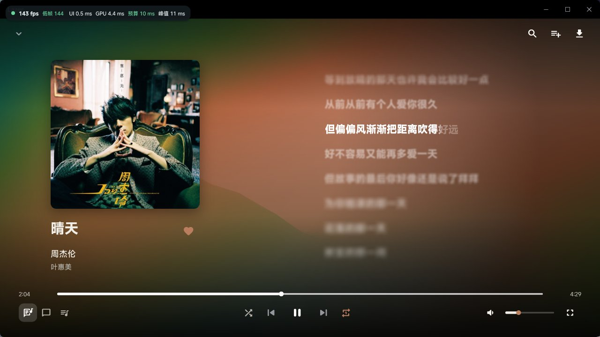
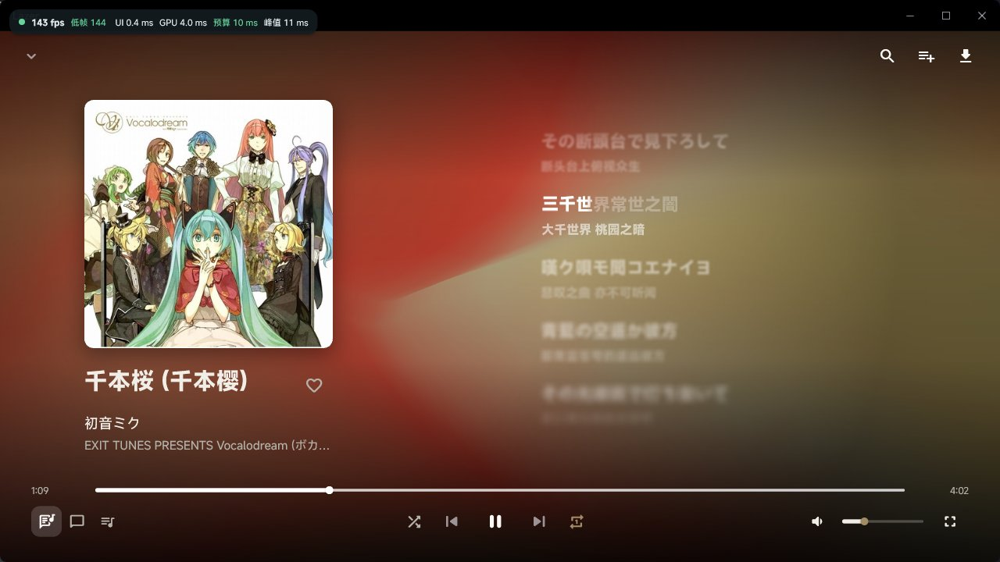
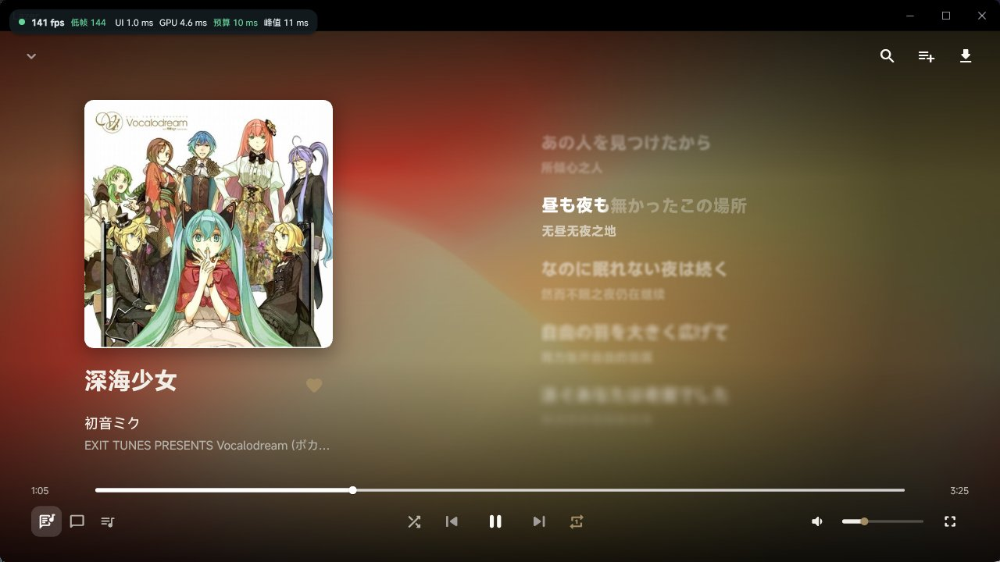
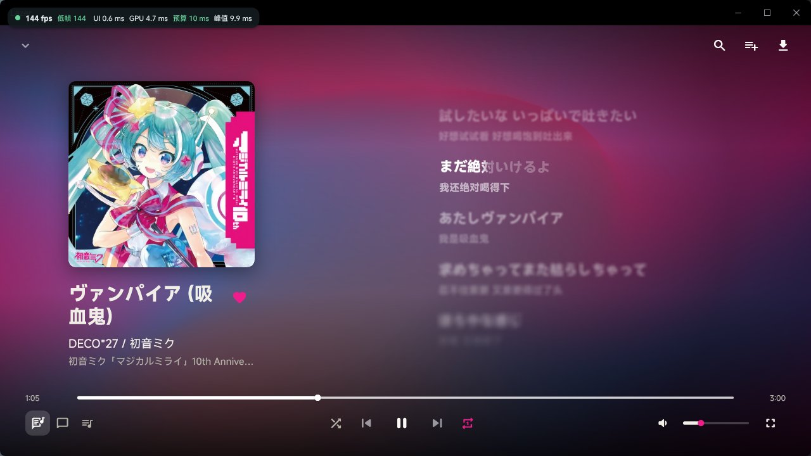
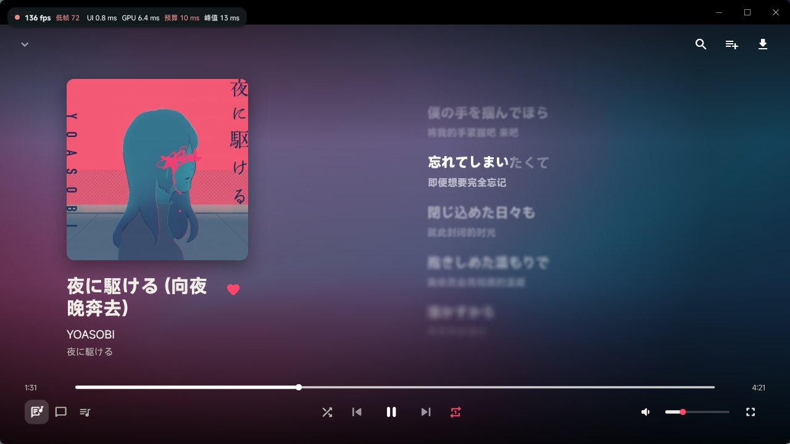
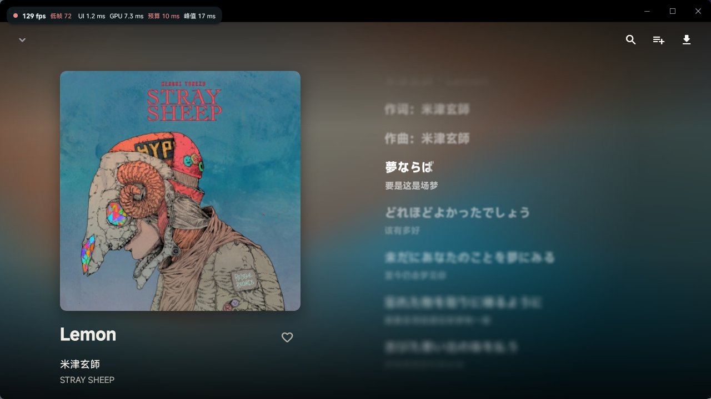
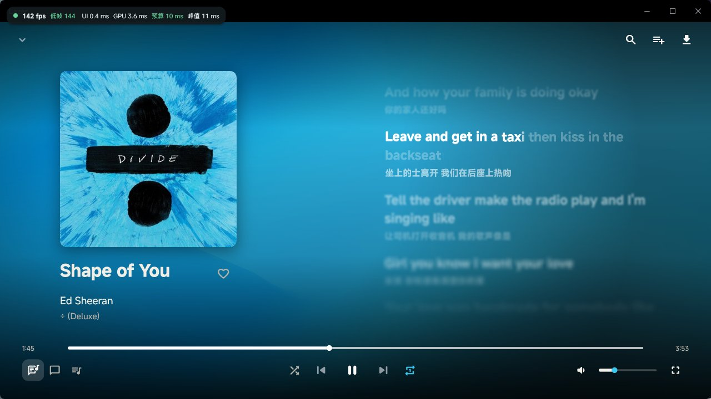

# 🎤 酷狗音乐逐字动感歌词 (KRC) 效果示范与实测曲库

本目录汇总了 `lazer.kugou`（酷狗音乐插件）在 Lazer 客户端原生运行时下的 **KRC 逐字动感歌词与双语翻译** 的实机播放效果演示与 10 首多语种、全曲风的实测高清截图。

---

## 🎬 动态播放效果实录 (GIF 演示)

### 🎵 周杰伦 - 《晴天》（华语逐字动感标杆，毫秒级平滑跟随，140+ FPS 稳定满帧）

---

## 🖼️ 多语种与全曲风静态实测效果集 (共 10 首示范)

### 🇨🇳 华语经典抒情与长音渲染
#### 1. 《晴天》 - 周杰伦 (63 行逐字跟随)

#### 2. 《江南 (粤语版)》 - 林俊杰 (47 行逐字长音与打点)

---

### 🎙️ 术力口 (Vocaloid) 殿堂高难度曲目
#### 3. 《千本桜》 - 初音ミク (传世快节奏，逐字高亮)

#### 4. 《深海少女》 - 初音ミク (经典抒情，双语逐字与中文翻译 1:1 绝对对齐)

#### 5. 《ロキ (洛基)》 - 鏡音リン / みきとP (70 行超高燃高频对唱打点)

#### 6. 《ヴァンパイア (吸血鬼)》 - DECO*27 / 初音ミク (72 行现代高热度密集跟随)

---

### 🇯🇵 日文流行 (J-POP)
#### 7. 《夜に駆ける (向夜晚奔去)》 - YOASOBI (88 行极速逐字跟随)

#### 8. 《Lemon》 - 米津玄師 (57 行抒情打点)

---

### 🌍 欧美流行 (Western POP)
#### 9. 《Rolling in the Deep》 - Adele (77 行英文逐词高亮与双语中文)

#### 10. 《Shape of You》 - Ed Sheeran (91 行英文律动节奏打点)

