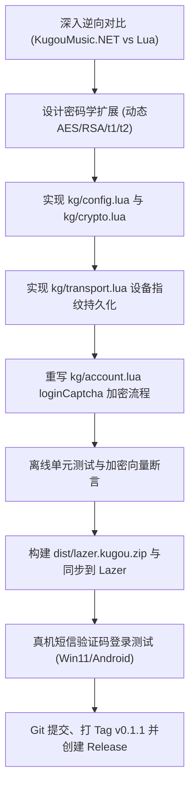

# 酷狗短信验证码登录协议加密逆向与 0.1.1 升级规划

**文档版本**：v1.0  
**制定日期**：2026-11-13  
**目标版本**：`lazer-plugin-kugou v0.1.1`  
**关联项目**：  
- `D:\aaaStuffsaaa\from_git\github\lazer-plugin-kugou` (当前插件)  
- `D:\aaaStuffsaaa\from_git\github\KugouMusic.NET` (Avalonia 4.2.2+ 参考实现)  
- `D:\aaaStuffsaaa\from_git\github\Lazer` (宿主 Dart 运行时)

---

## 一、 背景与现状分析

### 1.1 问题现象
在 Lazer 客户端（Win11 与 Android 双端）中接入酷狗音乐插件时：
1. **二维码扫码登录**：生成二维码、App 扫码、状态轮询与换取 Token 全部正常，登录成功。
2. **手机短信验证码登录**：
   - 输入手机号点击“获取验证码”，手机能正常收到酷狗短信。
   - 输入验证码点击“登录”，界面立即报红提示：**“登录失败，请稍后再试。”**
3. **同协议客户端表现**：
   - 在本地的 `KugouMusic.NET`（Avalonia 客户端）中测试同一个手机号与短信验证码，实测**登录成功**。

---

## 二、 协议逆向与差异根因分析

通过深入对比 `KugouMusic.NET` 的底层协议实现（`src/Libraries/KuGou.Net/Protocol/Raw/RawLoginApi.cs`）与当前 `lazer-plugin-kugou` 的 [account.lua](file:///D:/aaaStuffsaaa/from_git/github/lazer-plugin-kugou/kg/account.lua)，定位到根本原因：

### 2.1 为什么二维码登录能成功？
酷狗的二维码登录使用的是 Web 端轻量级接口：
- 获取二维码：`GET https://login-user.kugou.com/v2/qrcode?appid=1001&...`
- 轮询扫码状态：`GET https://login-user.kugou.com/v2/get_userinfo_qrcode?appid=3116&...`

这些接口只需要常规的 Web 签名（`crypto.calc_web_signature`，即简单的 URL 参数 MD5 拼盐），没有任何非对称与流式加密，当前插件中对此实现很完整，因此双端均可稳定成功。

### 2.2 为什么短信验证码登录会失败？
1. **发码阶段（成功）**：  
   `POST /v7/send_mobile_code` 为酷狗的开放通用发码接口，仅需普通明文 `{ businessid: 5, mobile: phone, plat: 3 }` 配合签名即可被服务器接受，因此手机能正常收到短信。
2. **验码登录阶段（失败致命点）**：  
   酷狗对于 `/v7/login_by_verifycode` 实施了移动端专用的**多层混合加密握手（Hybrid Encryption Handshake）**，包含动态 AES、RSA 无填充模幂、设备指纹派生与返回体密文解密。
   
   **当前插件的错误代码（明文裸传）**：
   ```lua
   -- kg/account.lua 现有实现：
   local res, err = transport.request({
     method = "POST",
     host = config.loginHost,
     path = "/v7/login_by_verifycode",
     body = {
       mobile = phone,
       code = captcha,
       plat = 1
     }
   })
   ```
   * 酷狗服务端识别到请求体中缺少必要的 `params`（加密载荷）、`pk`（加密密钥）、`t1`、`t2` 等安全握手凭证，直接判定为非法客户端请求并拒绝验证，导致返回错误。

---

## 三、 酷狗移动端短信验证码登录协议规范详解

根据 `KugouMusic.NET`（`RawLoginApi.cs` 与 `KgCrypto.cs`），酷狗移动端规范握手流程如下：

### 3.1 加密流程与参数矩阵

| 字段名 | 类型 | 说明与生成算法 |
| :--- | :--- | :--- |
| `clienttime_ms` | `int64` | 当前毫秒级时间戳（`host.now()`） |
| `tempKey` | `string` | 动态生成的随机 ASCII 字符串（16 字符） |
| `aesKey` | `string` | `MD5(tempKey)`，前 32 字符作为 AES-256 Key |
| `aesIv` | `string` | `MD5(tempKey)` 的后 16 字符作为 AES-256 IV |
| `params` | `string` | 使用上述 Key/IV 对 `{"mobile": phone, "code": code}` 进行 **AES-256-CBC (PKCS7)** 加密，得到小写 Hex |
| `pk` | `string` | 将 `{"clienttime_ms": now, "key": tempKey}` 格式化为 JSON，使用 **Lite RSA 公钥（无填充模幂）** 加密，转大写 Hex |
| `t1` | `string` | 对 `|{clienttime_ms}` 使用固定 Key（`5e4ef500e9597fe004bd09a46d8add98`）与 IV（`04bd09a46d8add98`）进行 AES-256-CBC 加密 |
| `t2` | `string` | 对 `{installGuid}|0f607264fc6318a92b9e13c65db7cd3c|{installMac}|{installDev}|{clienttime_ms}` 使用固定 Key（`fd14b35e3f81af3817a20ae7adae7020`）与 IV（`17a20ae7adae7020`）进行 AES-256-CBC 加密 |
| `key` | `string` | `MD5(appId + liteSalt + clientVer + clienttime_ms)` |
| `mobile` | `string` | 掩码脱敏手机号，例如 `17*****0` |
| `plat` | `int` | 固定为 `1` |
| `support_multi` | `int` | 固定为 `1` |
| `dfid` | `string` | 固定为 `"-"` |
| `dev` | `string` | 客户端生成的持久化设备名 `installDev` |
| `gitversion` | `string` | 固定为 `"5f0b7c4"` |

### 3.2 网络请求与服务端路由
* **请求域名**：`loginserviceretry.kugou.com`（酷狗登录服务专用域名，具备更高的网络容灾级别）
* **Path**：`/v7/login_by_verifycode`
* **专属 Header**：
  * `support-calm: 1`
  * `x-router: login.user.kugou.com`
* **签名规范**：URL 参数携带常规 `signature = crypto.calc_signature(params, body, liteSalt)`。

### 3.3 响应解密（Decryption）
当服务端校验成功返回 `status = 1` 时：
* 服务端返回的真实凭据（如 `userid`、`token` 等）包裹在 `res.data.secu_params` 的加密 Hex 中。
* 必须使用刚才生成的 `tempKey`（派生 `aesKey`/`aesIv`）对其进行 **AES-256-CBC 解密**。
* 解密出的明文 JSON 合并回 `res.data`，即可获得合法的 `userid`、`token`、`nickname`、`pic` 等完整资料。

---

## 四、 0.1.1 版本重构与实施方案

### 阶段一：密码学与设备指纹底层扩展 (`kg/config.lua` & `kg/crypto.lua`)
1. **配置常量补齐**（[config.lua](file:///D:/aaaStuffsaaa/from_git/github/lazer-plugin-kugou/kg/config.lua)）：
   - 增加 `liteT1Key = "5e4ef500e9597fe004bd09a46d8add98"`
   - 增加 `liteT1Iv = "04bd09a46d8add98"`
   - 增加 `liteT2Key = "fd14b35e3f81af3817a20ae7adae7020"`
   - 增加 `liteT2Iv = "17a20ae7adae7020"`
   - 增加 `t2FixedHash = "0f607264fc6318a92b9e13c65db7cd3c"`
   - 增加 `loginRetryHost = "loginserviceretry.kugou.com"`
2. **动态 AES 与 RSA 算法增强**（[crypto.lua](file:///D:/aaaStuffsaaa/from_git/github/lazer-plugin-kugou/kg/crypto.lua)）：
   - `crypto.random_string(len)`：生成随机 ASCII 字符串。
   - `crypto.aes_encrypt_dynamic(data)`：实现酷狗标准的动态 Key 派生与 AES-256-CBC 加密，返回 `(hexStr, tempKey)`。
   - `crypto.aes_decrypt_dynamic(hexData, tempKey)`：实现酷狗标准的响应体动态 AES 解密。
   - `crypto.calc_t1(timeMs)` 与 `crypto.calc_t2(installGuid, installMac, installDev, timeMs)`。
   - `crypto.rsa_encrypt_pk(pkData)`：利用 Lazer 的 `host.crypto({ operation = "rsa_modpow", width = 256 })` 执行无填充模幂加密并转大写。

### 阶段二：会话状态机与设备凭证持久化 (`kg/transport.lua`)
1. 对标 `KgSessionManager.cs`，在 Session 初始化时自举生成并持久化：
   - `installGuid`：32 位小写 Hex（未设置时随机生成）。
   - `installMac`：32 位小写 Hex（未设置时随机生成）。
   - `installDev`：16 位随机字符（未设置时随机生成）。
2. 保存至 `host.storage_set("kg_session")`，保证同一客户端设备指纹的幂等性与一致性。

### 阶段三：短信登录流程全面重构 (`kg/account.lua`)
1. **重写 `account.loginCaptcha(args)`**：
   - 参数校验：检查 `phone` 与 `captcha` 有效性。
   - 握手载荷构建：生成 `clienttime_ms`，计算 `params`、`pk`、`t1`、`t2`、`key` 和掩码手机号。
   - 发送请求：向 `loginserviceretry.kugou.com/v7/login_by_verifycode` 发起带有 `support-calm: 1` 和 `x-router` 的请求。
   - 响应解密：截获 `res.data.secu_params`，使用 `tempKey` 解密出真实的 `userid` 与 `token`。
   - 凭据持久化：写入 `transport.setSession`，并调用 `account.session()` 返回标准 UserProfile。

### 阶段四：验证与打包交付
1. **测试脚本验证**：
   - 编写 `test/test_login_crypto.py`，比对 Python/Node 模拟算法与 C# `RawLoginApi` 的加密输出一致性。
2. **构建与版本发布**：
   - `manifest.json` 版本升级至 `0.1.1`。
   - 运行 `node tools/build.js` 生成 `dist/lazer.kugou.zip` 并更新 SHA-256 校验和。
   - 自动同步至本地 Lazer 插件目录 `%APPDATA%\dev.naominet\lazer_nextgen\lua_plugins\lazer.kugou\`。
   - Git Commit、Tag `v0.1.1` 并发布 GitHub Release。

---

## 五、 实施计划甘特图与步骤分工



---

## 六、 风险评估与应对策略

| 风险点 | 影响程度 | 应对与防范策略 |
| :--- | :--- | :--- |
| **RSA 模幂在不同平台的填充差异** | 高 | 酷狗移动端要求无填充模幂（NoPadding），Lazer 宿主 `rsa_modpow` 默认就是裸模幂，通过配置 `width = 256` 保证输出精确为 128 字节 hex。 |
| **设备指纹随机导致频繁风控** | 中 | 首次生成 `installGuid`、`installMac` 和 `installDev` 后立即持久化到 Lazer 隔离存储，后续登录与操作复用同一设备标识。 |
| **移动端与 Web 端 Host 解析差异** | 低 | 严格使用 `loginserviceretry.kugou.com` 配合 `x-router: login.user.kugou.com`，对齐官方移动端容灾路由。 |
